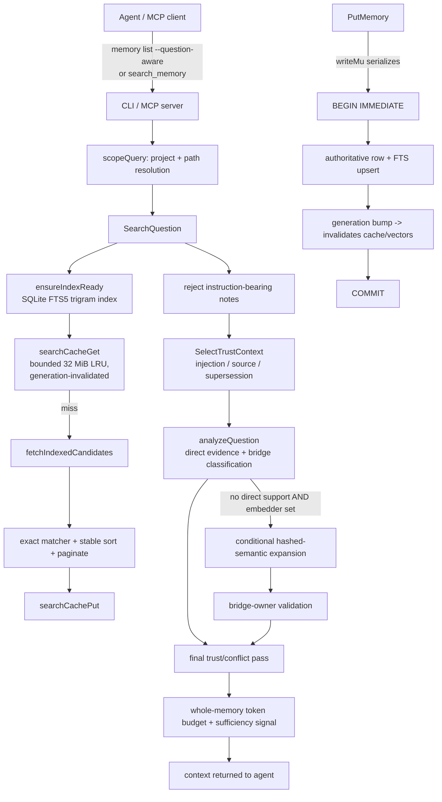

# Optimization architecture

This section documents the **memory-engine optimization and hardening work** layered
on top of the upstream Beacon V7 line. It is engineering documentation: what changed,
what was measured, and what remains open.

> **Attribution.** Agent Beacon is the open-source project by
> [Asymptote Labs](https://github.com/Asymptote-Labs/agent-beacon). This repository
> (MIT, `Copyright (c) 2026 Asymptote Labs`) is that project plus a series of
> optimization and hardening commits. The upstream product, its documentation, and
> its license notices are preserved unchanged.

## Lineage

```text
Original Beacon        99c709081ad49da1c5ade205929b61b19360ed9b   (frozen comparator)
V6 integration         209a987bc96c29b5e5d811a794d0357f20214463   (frozen)
Phase 5 (frozen eval)  02e34f98dec1c5d34a2f0d52904969edc39e389f   (frozen evidence)
V7 development         7b605aa84f0f570ba265fbda17fe6d99e927b10e   (optimization base)
Optimized (this work)  db341fbc1f32d16777ce21484163a6be71ecb688   (branch HEAD)
```

The optimized branch adds optimization and hardening commits after V7 development.
No frozen comparator ref was modified. The full commit list is in the
[roadmap](roadmap.md#commit-map).

## Data flow

Beacon's memory engine is a local SQLite store in front of a question-aware retrieval
path. The optimized path keeps the **same external interfaces** (the `beacon` CLI and
the `beacon mcp serve` MCP server) and the **same default behavior**; it changes how
retrieval selects context and how concurrent writes are serialized.



### Where the important code lives

| Concern | File |
|---|---|
| Question-aware retrieval | `cli/beacon/internal/learning/search_question.go` |
| Trust / supersession / contradiction selection | `cli/beacon/internal/learning/context_select.go` |
| Store, write serialization, generation | `cli/beacon/internal/learning/store.go` |
| Lexical search + cache | `cli/beacon/internal/learning/search.go`, `search_cache.go` |
| FTS index readiness | `cli/beacon/internal/learning/search_question_index.go` |
| Optional semantic / ANN | `cli/beacon/internal/learning/search_semantic.go`, `internal/hnsw` |
| Database placement + migration | `cli/beacon/internal/learning/placement.go` |
| Authenticated provenance | `cli/beacon/internal/learning/provenance.go` |
| MCP server | `cli/beacon/internal/mcpserver/` |
| Memory CLI call site | `cli/beacon/cmd/memory.go` |

## The three optimization themes

### 1. Write concurrency (durability-preserving serialization)

The store uses `_txlock=immediate` with a 30 s `busy_timeout`. Under 16 concurrent
writers, every connection attempted `BEGIN IMMEDIATE` and then **busy-polled SQLite's
single write lock**, producing a super-linear tail (16-client write p99 of **634 ms**
versus ~130 ms at 8 clients) with throughput collapse.

**Change:** a process-level `writeMu sync.Mutex` in `Store` that `PutMemory` holds
around the write transaction. Writers now park on a cheap Go mutex instead of spinning
in the SQLite busy handler. **Durability is unchanged** — every write still commits
under WAL, `synchronous` is untouched.

**Result:** 16-client write p99 **634 ms → 48–54 ms** on a local filesystem, zero
errors/busy. See [performance](performance.md) and
[`reports/v7-hardening/D_DATABASE_CONCURRENCY_FIX.md`](../../reports/v7-hardening/D_DATABASE_CONCURRENCY_FIX.md).

### 2. Retrieval allocations (question-aware selection)

`SearchQuestion` builds and compares significant-term sets for each candidate to run
trust, supersession, and contradiction logic. Profiling showed `significantTerms` was
recomputed up to three times per call and `intersectTerms` allocated per pair even when
only a count was needed.

**Change:** compute term sets once per memory and share them; use an allocation-free
`sharedCount` where only the count matters; skip supersession tokenization when no
memory can supersede.

**Result:** **2,007 → 875 allocs/op (−56.4%)** and 208 KB → 130 KB/op (−37.3%) on the
reference warm workload, with no correctness regression. See
[`reports/v7-hardening/RETRIEVAL_ALLOCATION_FIX.md`](../../reports/v7-hardening/RETRIEVAL_ALLOCATION_FIX.md).

### 3. Database placement + secure lifecycle

- **Placement:** `BEACON_MEMORY_DIR` sets an explicit local database directory;
  `CheckPlacement` detects synchronized/network mounts (WSL `drvfs`/`9p`, `cifs`,
  `nfs`, `fuse`, UNC) and warns; `MigrateDatabase` copies with `VACUUM INTO`
  (WAL-consistent) plus `integrity_check` and row-count verification, and refuses to
  overwrite or delete the source.
- **Lifecycle:** project authorization on memory reads/search/context (fail-closed
  allowlist), atomic candidate approval/supersession, bounded search and request-shape
  limits, and an opt-in Ed25519 authenticated-provenance mechanism.

See [security](security.md) and [`reports/security/`](../../reports/security/).

## Design tradeoffs

| Choice | Benefit | Cost |
|---|---|---|
| Serialize writes with a Go mutex | Collapses the concurrency tail; keeps WAL durability | Write median rises (queuing); single-writer ceiling remains |
| Allocate term sets once | −56% allocations | More code paths (`…WithTerms` variants); old signatures kept for callers |
| Conditional semantic expansion, off by default | Two-hop recall when lexical support is absent | Not re-ablated; stays opt-in ([limitations](limitations.md)) |
| Fail-closed authorization allowlist | Cross-project reads blocked when configured | Default single-user local mode does not enforce it (by design) |
| Opt-in authenticated provenance | Forged `source:verified` cannot elevate | No protected key authority shipped; deployment **BLOCKED** |

## Reproduction environment

All measurements in these reports were taken on a WSL2 Ubuntu host (8 vCPU,
7.6 GiB RAM, Linux/amd64, Go 1.27, `CGO_ENABLED=0`). Wall-clock numbers are
SQLite- and I/O-bound on that host; **allocation counts are the stable reported
metric**. Exact commands are in [benchmarks](benchmarks.md).
